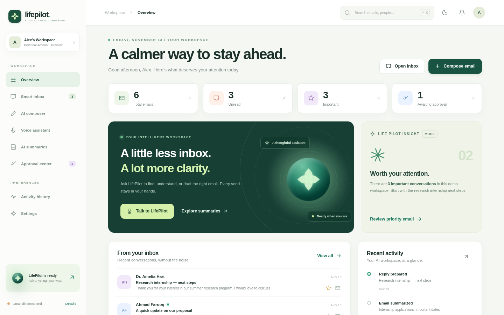
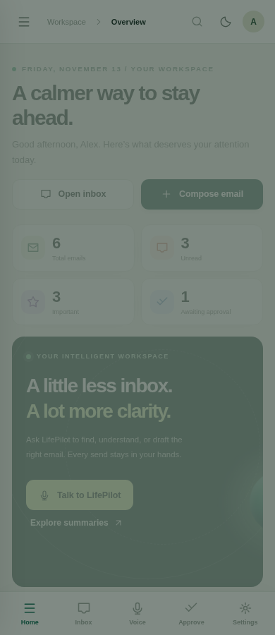
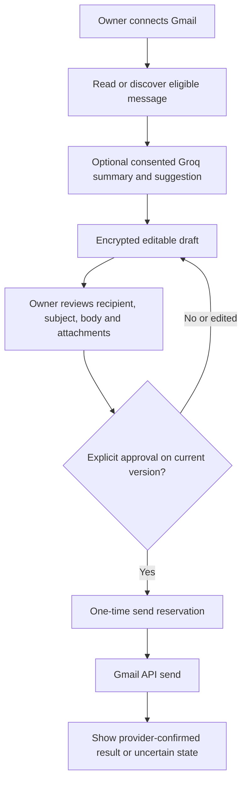

<div align="center">

# ✦ LifePilot AI

**An AI-powered Gmail copilot built around one principle: your email, your approval.**

A full-stack personal email workspace that combines Google OAuth, Gmail search, Groq-powered summaries and writing assistance, editable drafts, Roman Urdu and English voice commands, and an explicit review-before-send workflow.

**React · TypeScript · Vite · Node.js · Express · Gmail API · GroqCloud · SQLite · PWA · Android TWA scaffold**

[Features](#features) · [Architecture](#architecture) · [Getting started](#getting-started) · [Testing](#testing) · [Deployment status](#deployment-status) · [Security](#security)

</div>

> [!IMPORTANT]
> **Portfolio release status: development / integration validation.** The repository contains working application source and tests, but **does not represent an independently verified cloud deployment or an installable Android APK**. Gmail and Groq require your own credentials, local configuration, explicit consent, and testing. No real email is sent without the approval flow.

## Preview

The screenshots below depict the **offline UI preview with fictional data**, not a live connected Gmail account.

| Desktop preview | Mobile preview |
| --- | --- |
|  |  |

## The problem

Email takes time: reading conversations, identifying follow-ups, writing clear replies, and remembering commitments. LifePilot explores an **approval-first assistant** that helps prepare responses while keeping account access and final sending decisions under the owner's control.

## Features

| Area | Source implementation | Operational notes |
| --- | --- | --- |
| **Gmail connection** | OAuth 2.0 callback, protected session, account allowlist, Gmail client | Requires owner-managed Google Cloud project and Gmail API permissions |
| **Inbox & threads** | Search, filters, message reading, threaded replies | Real data only after OAuth; isolated fictional demo mode |
| **AI-assisted writing** | GroqCloud provider, structured reply/compose endpoints, encrypted drafts | Requires configured model/key and explicit third-party AI consent |
| **Roman Urdu summaries** | Three language styles: Roman Urdu, simple English and professional English | Model outputs require user review; no guarantee of perfect factual accuracy |
| **Voice & text commands** | Intent parsing, browser speech recognition, typed fallback, speech synthesis | Browser/microphone capabilities vary; not always listening |
| **Approval center** | Versioned drafts, content fingerprints, reapproval after edits, one-time send reservation | AI never directly calls Gmail send; failed/uncertain sends are not blindly retried |
| **Automatic monitoring** | Gmail history cursor, manual check, scheduled-worker route, eligible-email filtering, deduplication, queued AI review drafts | Needs a **deployed, persistent HTTPS backend and scheduler** for PC-off operation; not proven live |
| **Notifications** | Optional Firebase Cloud Messaging integration and device registrations | Requires FCM setup and an end-to-end push test |
| **Web/mobile UI** | Responsive React interface, dark/light themes, PWA assets | Android TWA project is a *scaffold*, not a released APK |

### Email approval lifecycle



## Architecture

```text
                        OWNER'S BROWSER / PWA
                     React + TypeScript + Vite
                     Responsive UI / Voice UX
                                │
                             HTTPS API
                                │
                           Express backend
                      /          │           \
                     /           │            \
            Gmail OAuth/API    Groq AI       Draft & settings store
               (Google)     (consented)     (encrypted SQLite)
                                │
                Optional scheduled Gmail history monitor
                                │
                          Optional FCM alerts

               Android: TWA scaffold around deployed PWA
```

**Project layout**

```text
src/                 React screens, styles, types, API clients, demo engine
backend/src/         Express server, OAuth/Gmail, security, encrypted store
backend/src/ai/      Groq provider, prompts, schemas, intent and routes
backend/src/monitoring/  Gmail cursor, triage and push notification workers
backend/test/        Mocked security, API and workflow tests
tests/               Preview and Playwright test sources
android/             Android Trusted Web Activity scaffold
cloud/               Cloud VM, reverse proxy, scheduler configuration
public/              PWA manifest, service worker and icons
docs/                Setup, API, security, audit and deployment guides
```

## Getting started

**Prerequisites:** Node.js **22+**, npm, a Google Cloud project, Gmail API enabled, an OAuth **web** client, and (optionally) a GroqCloud API key. The app is intended for **one allowlisted Gmail account**. Never paste credentials into GitHub issues, screenshots, or source files.

1. Clone:

   ```bash
   git clone https://github.com/saimbashir/LifePilot-AI.git
   cd LifePilot-AI
   ```

2. Install both project dependency sets:

   ```bash
   npm install
   npm --prefix backend install
   ```

3. Copy `backend/.env.example` to `backend/.env` and fill in secrets **locally**. Keep `backend/.env` untracked. Follow [`docs/GOOGLE_OAUTH_SETUP.md`](docs/GOOGLE_OAUTH_SETUP.md). For local development the callback is `http://localhost:8787/api/auth/google/callback`, and the frontend is `http://localhost:5173`. Do not change your encryption key after storing encrypted data unless you migrate it safely.

4. Start the backend:

   ```bash
   npm run dev:backend
   ```

5. In a separate terminal start the frontend:

   ```bash
   npm run dev
   ```

6. Open **http://localhost:5173**. Use **Demo** without Gmail, or enable **Real Gmail** via Settings. AI actions need a configured backend provider and explicit processing consent.

> `backend/.env.example`, `.env.frontend.example`, and cloud configuration examples contain placeholders only. Local `.env`, databases, signing keys, credentials and token files **must not be committed**.

## Testing

Commands to run locally or in CI when dependencies are installed:

```bash
npm run typecheck
npm run build
npm run check:backend
npm run test:backend
npm test
npx playwright install chromium
npm run test:e2e
```

The most recent included **mock-test report** is [`docs/AUTO_APPROVAL_TEST_REPORT.md`](docs/AUTO_APPROVAL_TEST_REPORT.md). Historical results are not a guarantee that every runtime, cloud or device integration works. **Live Gmail OAuth/send, cloud PC-off monitoring, browser speech support and Android push must be tested with controlled accounts/devices before release.**

## Deployment status

| Deliverable | State |
| --- | --- |
| Local web application source | Included |
| Real Gmail/Groq adapters | Included; owner credentials and live validation required |
| Persistent cloud deployment | Configuration included; **not publicly deployed** |
| PC-off continuous monitoring | Worker source included; **not verified on a live persistent host** |
| Android application | TWA source included; **no verified installable APK** |
| Firebase push | Optional integration; **device delivery unverified** |

Read [`docs/AUTOMATIC_APPROVAL_PC_OFF_RUNBOOK.md`](docs/AUTOMATIC_APPROVAL_PC_OFF_RUNBOOK.md), [`docs/MODULE4_DEPLOYMENT.md`](docs/MODULE4_DEPLOYMENT.md), and [`docs/MODULE4_ANDROID.md`](docs/MODULE4_ANDROID.md) before attempting release. A testing-stage Google OAuth app using Gmail restricted scopes can require frequent reauthorization and may need verification for wider/public deployment.

## Security

- **No API keys in the browser or Android binary**: Google OAuth secrets, Groq keys and encryption keys stay on the backend.
- **User approval required before sending**: changes invalidate prior approval; duplicate send attempts are guarded.
- **Sensitive data minimized and encrypted** in the server-side store. Do not publish SQLite databases or backups.
- **Incoming email is untrusted**: model suggestions are not delegated the authority to perform actions.
- **Consent-based AI processing**: selected message content may be shared with Groq when you enable consent.
- **Mock and real workspaces are separate**: fictional data must never be represented as real mail.

See [`docs/SECURITY.md`](docs/SECURITY.md), [`docs/MODULE4_PRIVACY_SECURITY.md`](docs/MODULE4_PRIVACY_SECURITY.md), and [`SECURITY.md`](SECURITY.md). If an API key was ever exposed, **rotate it before use**.

## Roadmap / known limitations

- Establish reproducible dependency-backed React build and full browser E2E validation on the final source revision.
- Deploy an HTTPS backend with durable encrypted storage, monitoring scheduler, secure sessions, and reliable backup/recovery.
- Run live OAuth, Gmail threading and approved-send acceptance tests with accounts owned by the developer.
- Build/sign Android TWA after domain ownership and digital asset links are configured; verify FCM and deep links on a device.
- Resolve Google OAuth restricted-scope verification and free-tier hosting policy before any public release.

## Portfolio notes

LifePilot AI demonstrates **full-stack system design**, Gmail OAuth, typed React API integration, structured generative AI workflows, security-conscious draft approval, SQLite-backed state, and asynchronous monitoring/notification architecture. The project is **an implementation under deployment validation**, not a claim that the cloud or Android release is already live.

## Project ownership and licensing

Developed as a personal learning and portfolio project. **No open-source license is currently granted**; please contact the repository owner if you wish to reuse the code. See the GitHub repository for contributions and issues.
