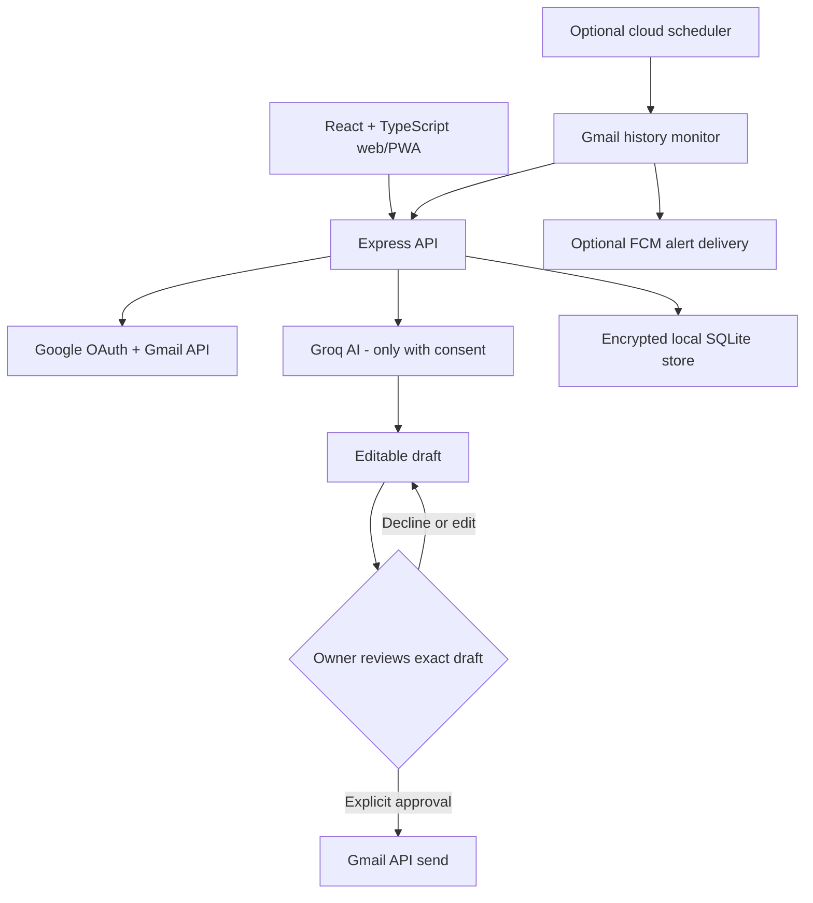

<div align="center">

# ✦ LifePilot AI

**Your inbox. Your AI copilot. Your final approval.**

A full-stack, voice-enabled Gmail assistant for understanding conversations, producing Roman Urdu and English summaries, preparing professional replies, and keeping a human approval step before every outgoing email.

**React · TypeScript · Vite · Node.js · Express · Gmail API · GroqCloud · SQLite · PWA**

[Features](#key-features) · [Architecture](#architecture) · [Local setup](#local-setup) · [Testing](#testing) · [Security](#security) · [Release status](#release-status)

</div>

> [!IMPORTANT]
> **Development / portfolio build — not a verified production deployment.**
> Gmail and Groq integrations require private configuration and user consent. Cloud monitoring, Android packaging, and device push notification delivery require separate deployment and live validation. **AI-generated drafts are never sent automatically.**

## About

LifePilot AI is an approval-first email productivity project that explores how an AI assistant can reduce repetitive inbox work **without taking away control of email sending**. It combines a responsive web experience with OAuth-secured Gmail operations, structured AI assistance, encrypted drafts, and optional monitoring.

## Key features

| Capability | Implementation | Important qualification |
|---|---|---|
| **Gmail OAuth 2.0** | Google sign-in, session handling and account allowlist | Requires a Google Cloud project and scopes |
| **Smart inbox** | Real message retrieval, searching, threads and filtering | Real mail appears only after account authorization |
| **Groq AI assistance** | Context-aware summaries and suggested email replies | Requires Groq key plus explicit third-party processing consent |
| **Roman Urdu support** | Roman Urdu, simple English and professional English summaries | AI output is not guaranteed error-free |
| **Voice and text commands** | Intent parsing, browser speech recognition, text fallback and TTS | Browser/device speech support varies |
| **Draft approval center** | Editable drafts, content fingerprint/version checks, user approval | AI cannot invoke the Gmail send action directly |
| **Automatic review preparation** | Optional eligible-inbox filtering, summaries and review-only drafts | Needs an active, configured monitoring worker |
| **Duplicate-send protection** | One-time send reservation and Gmail response checks | Do not blindly retry uncertain sends |
| **Notifications** | Optional Firebase Cloud Messaging integration | Requires account/device setup and testing |
| **Mobile-ready experience** | Responsive React frontend, PWA and Android TWA scaffold | No verified signed Android APK is included |

## Screenshots

The images in `docs/screenshots/` show the **offline demonstration UI** with fictional data, not a connected private Gmail account.

- [Desktop preview](docs/screenshots/preview-desktop.png)
- [Mobile preview](docs/screenshots/preview-mobile.png)

## Architecture



**Repository layout**

```text
src/                    React screens, styles, types and typed API clients
backend/src/            Express, Gmail, security and encrypted store
backend/src/ai/         Groq provider, prompt templates and intent parsing
backend/src/monitoring/ Gmail incremental sync, triage and notifications
backend/test/           Mocked integration and security tests
tests/                  Preview tests and Playwright browser test sources
public/                 PWA manifest, icons and service worker
android/                Trusted Web Activity project scaffold
cloud/                  Cloud VM and scheduler configuration
docs/                   API, Google OAuth, privacy, Android and deployment guides
```

## Local setup

**Requirements:** Node.js 22+, npm, a Google Cloud OAuth web client, enabled Gmail API, and optionally a GroqCloud key. Use a non-sensitive test account during development.

```bash
git clone https://github.com/saimbashir/LifePilot-AI.git
cd LifePilot-AI
npm install
npm --prefix backend install
```

Copy `backend/.env.example` to `backend/.env` and configure the Google client ID, **private** client secret, account allowlist, stable encryption key, and optional Groq key **on your own machine**. Never upload `backend/.env` or the local SQLite database.

Start the backend and frontend in separate terminals:

```bash
npm run dev:backend
npm run dev
```

Open **http://localhost:5173**. The local Gmail OAuth callback expected by this codebase is `http://localhost:8787/api/auth/google/callback`. For complete setup, see [Google OAuth instructions](docs/GOOGLE_OAUTH_SETUP.md) and [project setup](docs/AUTOMATIC_APPROVAL_PC_OFF_RUNBOOK.md).

**Demo mode** uses clearly labeled fictional messages. **Real Gmail mode** requires authorization. Groq processing must be specifically enabled and consented to before selected message content is transmitted to the external AI provider.

## Testing

Run these commands after installing dependencies:

```bash
npm run typecheck
npm run build
npm run check:backend
npm run test:backend
npm test
npx playwright install chromium
npm run test:e2e
```

The latest source archive was checked with **92 passing backend tests, 1 skipped test, and 6 passing offline-preview tests**. The full React typecheck/build was **not verified** in that environment because required React/Firebase packages were not installed. These results cover mocks and local source checks, **not** end-to-end Gmail, cloud, or Android acceptance testing. See [test evidence](docs/AUTO_APPROVAL_TEST_REPORT.md).

## Release status

| Deliverable | Current status |
|---|---|
| Frontend and backend source | Included in the latest development archive |
| Gmail and Groq API integration source | Included; requires secret configuration and live testing |
| Local email inbox/AI model checks | Previously demonstrated by owner; full workflow requires validation |
| Automatic processing source | Included; production scheduler not deployed |
| Persistent cloud-hosted web app | **Not yet deployed/verified** |
| PC-off monitoring | **Not yet verified** |
| Signed Android APK | **Not yet built/verified** |
| Firebase push to a device | **Not yet verified** |

See [deployment guide](docs/MODULE4_DEPLOYMENT.md), [Android guide](docs/MODULE4_ANDROID.md), and [PC-off monitoring runbook](docs/AUTOMATIC_APPROVAL_PC_OFF_RUNBOOK.md).

## Security

- AI proposes drafts only; it never directly sends email.
- Every outgoing email requires explicit approval of the **current** recipient, subject, body, attachments and draft version. Edits invalidate existing approval.
- API keys, Google OAuth tokens, encryption keys, private email data and Firebase service-account credentials belong **only** in server-side secrets or untracked local configuration.
- Received emails are **untrusted content**, not commands for the AI or the application.
- Real email content is shared with Groq only after explicit processing consent.
- Avoid exposing email data in screenshots or public issue reports. Rotate any previously exposed keys.

See [SECURITY.md](SECURITY.md) and [security architecture](docs/MODULE4_PRIVACY_SECURITY.md).

## Roadmap

- Reproducible dependency-backed production builds and end-to-end browser testing.
- Controlled live Gmail send and reply-thread verification with owned test accounts.
- Cloud HTTPS deployment, durable encrypted storage, scheduled monitoring and backup/recovery.
- Android TWA packaging, secure app links, notification delivery and device testing.
- Gmail OAuth restricted-scope verification and real free-tier quota measurement.

## Portfolio context

**Engineering focus:** TypeScript/React frontend, Node/Express REST backend, OAuth 2.0, Gmail API, structured LLM workflows, account-safe approval controls, encrypted data persistence, asynchronous monitoring, and mobile/cloud integration design.

**Licensing:** This is a personal portfolio project; no open-source license is granted unless the repository owner adds one.
