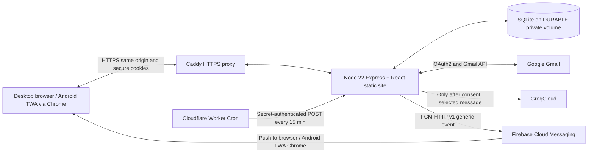

# Module 4 System Architecture — Source-level design, not deployed

**Trust boundaries**

- Browser/TWA: public UI only. Holds short-lived HttpOnly session cookie, not OAuth tokens or Groq keys. CSRF header required on authenticated mutations.
- Node backend: sole authority for identity, Gmail calls, AI consent, drafts and sending. `POST /api/drafts/:id/send` is unchanged from Module 3 and requires a reviewed approved version and matching approval ID.
- SQLite: encrypted Gmail tokens, drafts, attachments and FCM registration tokens. Monitoring event table contains opaque Gmail message IDs and timestamps, *not* message body.
- Scheduler: a separate random secret authenticates the scheduled endpoint. Cloudflare Worker has **no access** to encryption key/Gmail tokens/AI key/DB.
- Firebase: only generic notification text, opaque message ID and route, no lock-screen email body.
- Groq: selected message content is sent only on a direct user request after the existing AI opt-in. **Background monitoring never automatically calls Groq.**

**Availability guarantee:** A Worker cron trigger cannot keep data durable. For always-on monitoring, the Node backend and its attached SQLite volume MUST live on a persistent, reachable HTTPS server. The project cannot claim that this exists until deployed and verified.

**Concurrency:** single Node process, one writable SQLite database; `BEGIN IMMEDIATE` transactional send reservation. Do not horizontally scale with separate local SQLite copies. For multi-instance production, migrate to a transactional shared database with distributed locks and idempotency.

**OAuth:** Browser and Android TWA use the same HTTPS site origin, mitigating WebView third-party-cookie problems; OAuth and deep links still require real-device testing. No native key is distributed.
